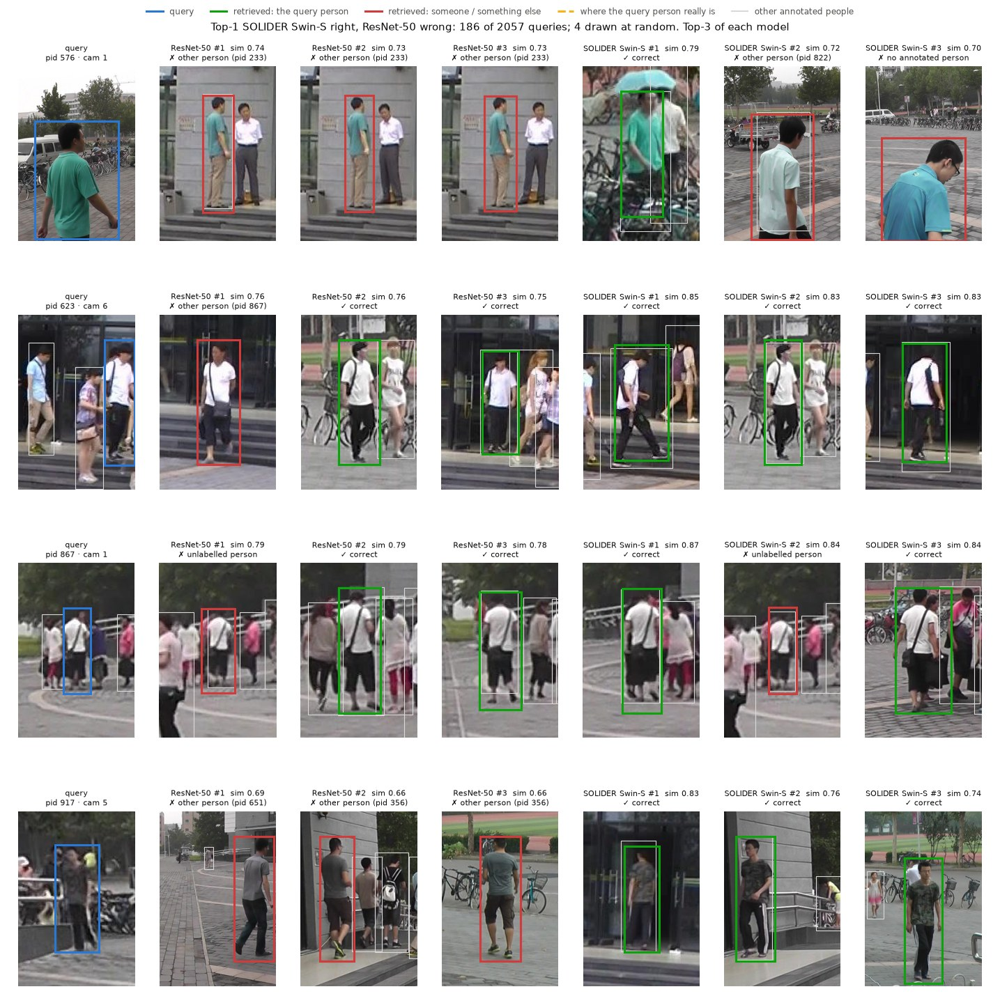
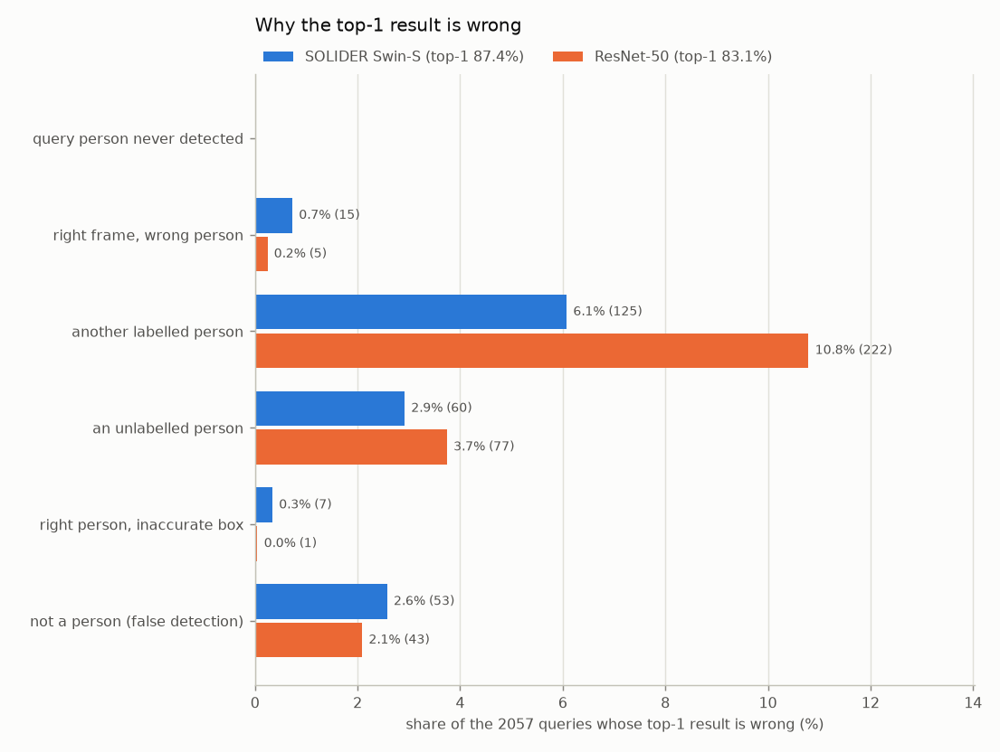
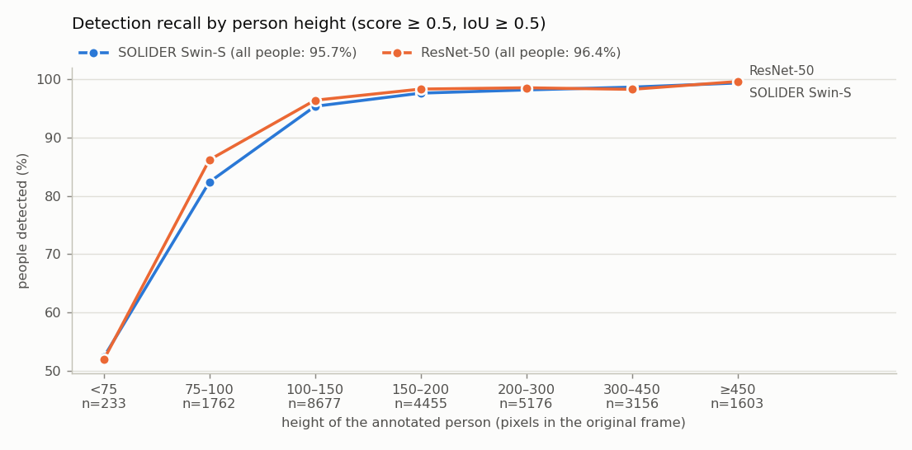

# Person search on PRW: SeqNet with a SOLIDER Swin-S backbone

Project for the *Machine Learning for Computer Vision* course (University of Bologna). **Person search** combines person detection and re-identification: given a query person cropped from one image, find that person in a gallery of full, unannotated scene images taken by other cameras.

This repository reimplements **SeqNet** (Li & Miao, AAAI 2021) and trains it on PRW, first with ResNet-50 and then with the **SOLIDER Swin-S** backbone (Chen et al., CVPR 2023). Every number is computed with the evaluation function provided by the course (`eval_search_prw`), which is kept unchanged.

| Model (PRW test set) | mAP | top-1 |
| --- | --- | --- |
| First course submission (Faster R-CNN FPN + NAE + OIM) | 27.21 | 59.70 |
| SeqNet, ResNet-50 | 46.40 | 83.08 |
| SeqNet, SOLIDER Swin-S | 60.19 | 87.36 |
| SeqNet, SOLIDER Swin-S + flip test-time augmentation | **63.06** | **88.48** |

The full write-up, with method, training curves, quantitative and qualitative results, is in **[`main.ipynb`](main.ipynb)**.

## The task

**PRW** (Zheng et al., CVPR 2017) has 11,816 frames from six cameras on a university campus: 5,704 frames for training and 6,112 test frames that form the gallery. There are 932 identities and 2,057 queries. For every query, the model detects the people in all the other test frames and ranks the detections by similarity to the query. A detection counts as correct when it overlaps the query person's ground-truth box.

- **mAP:** average precision of each ranking, scaled by the share of the query person's appearances that were detected, then averaged over all queries.
- **top-1:** the share of queries whose best-ranked detection is correct.

The evaluation function is fixed, so gallery-level re-ranking (such as SeqNet's CBGM) is not used: all improvements are on the model side.

## Approach

**SeqNet.** A two-stage network on a shared stem:

1. A region proposal network and a Faster R-CNN head detect people and refine their boxes.
2. A second head, with its own weights, computes a 256-d embedding from the refined boxes. This **Norm-Aware Embedding** uses the vector's direction for identity and its norm for the person score.

The embedding is trained with the **OIM** loss (a lookup table of 482 training identities plus a queue of 500 unlabelled people). At test time, the detection score comes from stage 1, and each gallery embedding is weighted by its detection score (confidence-weighted similarity). The reimplementation follows the official code and recipe and reproduces the paper (46.40 vs 46.7 mAP). A parity test against the official code gave identical parameters, losses, gradients and outputs.

**SOLIDER Swin-S backbone.** Swin stages 1–3 replace the ResNet-50 stem, and stage 4 replaces the res5 head in both stages, as in SOLIDER-PersonSearch. SOLIDER pre-trains the Swin without labels on LUPerson, 4.18M images of people. Its features describe clothing, textures and body parts, which gives **+13.8 mAP** over the ImageNet ResNet-50, slightly above the published result for the same model (59.84 / 86.73).

**Flip test-time augmentation.** Each gallery detection and query is also embedded from the mirrored image. The two normalised embeddings are averaged, which adds **+2.9 mAP** without retraining. Published methods do not use test-time augmentation, so the like-for-like comparison is 60.19. For reference, recent methods report about 60–62 mAP.

**What did not help.** Training the randomly initialised heads with a 10× higher learning rate improved detection slightly but lowered search accuracy: 58.79 mAP, −1.4.

## Qualitative findings

Retrieved boxes are compared with the people annotated in each frame. The examples are drawn at random within each group, and every figure reports the size of its group.

- **Swin-S mainly reduces confusions between people:** wrong top-1 results that are another labelled person drop from 222 to 125 out of 2,057 queries. It matches patterns, accessories and occluded people, where ResNet-50 mostly matches clothing colour.
- **Its detector is slightly weaker on small people:** 82% vs 86% recall for people 75–100 px tall. Above 150 px, both detect more than 97.5% of the people.
- **Part of the measured error is annotation noise:** some "wrong" results are people that PRW left unannotated, sometimes the query person themselves.



<p>
  
  
</p>

## Repository structure

```text
main.ipynb               the project notebook: dataset, method, training, results, qualitative analysis
Scripts/
  seqnet.py              SeqNet: RPN, Faster R-CNN head, re-ID head, NAE, FCS, CWS
  backbone.py            ResNet-50 stem and res5 head, or the SOLIDER Swin backbone
  swin.py                SOLIDER Swin split for SeqNet (stages 1-3 stem, stage 4 RoI head), weight loader
  swin_transformer.py    SOLIDER's Swin Transformer with the semantic controller
  oim.py                 OIM loss
  prw.py                 PRW dataset and loaders
  transforms.py          training augmentation (horizontal flip)
  config.py              default configuration (the official SeqNet PRW recipe)
  engine.py              training loop, feature extraction, optional flip test-time augmentation
  evaluate.py            course evaluation function eval_search_prw (unchanged)
  train.py               training
  eval_prw.py            evaluation
  qualitative.py         qualitative figures from the saved features
configs/                 ResNet-50, SOLIDER Swin-S and head-lr x10 configurations
exp_*/                   per model: configuration, training logs, evaluation results
results/qualitative/     qualitative figures and statistics
tools/                   download scripts for PRW and the SOLIDER weights
archive/course_submission_v1/   the first course submission, unchanged
```

`report.md` and `weights/` belong to the first submission.

## Credits and licenses

- The SeqNet code is adapted from [serend1p1ty/SeqNet](https://github.com/serend1p1ty/SeqNet) (MIT License, see `LICENSE-SeqNet`). Each adapted file starts with a header that lists its changes.
- The Swin Transformer code is from [SOLIDER](https://github.com/tinyvision/SOLIDER) (Apache License 2.0, see `LICENSE-SOLIDER`), and the backbone integration follows [SOLIDER-PersonSearch](https://github.com/tinyvision/SOLIDER-PersonSearch).
- `Scripts/evaluate.py` was provided by the course.

All credit for the methods goes to their authors:

- Z. Li and D. Miao, *Sequential End-to-end Network for Efficient Person Search*, AAAI 2021.
- W. Chen et al., *Beyond Appearance: a Semantic Controllable Self-Supervised Learning Framework for Human-Centric Visual Tasks*, CVPR 2023.
- D. Chen et al., *Norm-Aware Embedding for Efficient Person Search*, CVPR 2020.
- T. Xiao et al., *Joint Detection and Identification Feature Learning for Person Search*, CVPR 2017.
- L. Zheng et al., *Person Re-identification in the Wild*, CVPR 2017.
